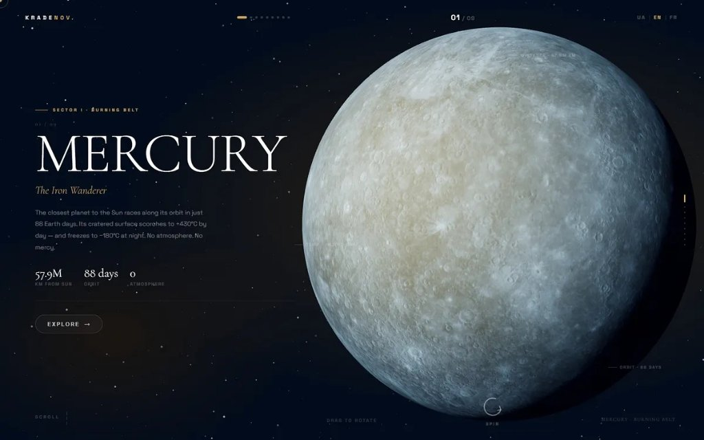

# UI/UX DESIGN BRIEF & VISUAL SYSTEM SPECIFICATION (REV 2): NusaShift
**Coupled Earth-System Regime & Lag-Cascade Detective**

* **Revision:** 2 — "Cinematic Earth + Narrative Dashboard". This revision **replaces** Rev 1 (Tactical Geospatial Telemetry / 3-column bento HUD). Do not mix instructions from the old version.
* **Target Agent:** Any autonomous coding agent. Implementation is split into 4 sessions in `docs_production/NASA_MasterPrompt_DesignRevision.md`.
* **Stack (unchanged):** Next.js 16 (App Router, `reactCompiler: true`) + React 19 + TypeScript `strict` + **Tailwind CSS v4** (CSS-first `@theme` in `src/app/globals.css`, no `tailwind.config.*`) + Recharts + Lucide + `react-globe.gl` / `three`.
* **New dependency (only one):** `lenis` (smooth scroll). No other animation library.
* **Language Mandate:** 100% English UI copy, labels, tooltips, and readouts.
* **Source of truth for data and claims:** `NASA_SSOT_FIX.md`. This brief controls **how it looks and flows**, never what the numbers are.

---

## 0. Why This Revision Exists

Problems observed on the shipped dashboard (below the hero):

1. Every statistic (τ, Z, p-value, Sen's slope, Pettitt, CI) is shown at the same level, so a non-specialist cannot tell what matters.
2. Statistical jargon appears before any plain-language answer.
3. Panels have equal visual weight, so there is no reading order.
4. Body text and numbers are too small (10–11px) with low contrast.
5. Inter is the default "AI template" font.

Requirement from the team PIC: **a user must be able to understand what the dashboard is telling them without statistics training.** The fix is structural, not cosmetic: the dashboard becomes a story with one message per section.

**What is kept from Rev 1:** the approved full-viewport hero composition at 1440px (full-bleed globe with controls over it), the semantic color meanings, the 1px hairline border language, `font-mono tabular-nums` for numbers, and the anti-slop rules.

---

## 1. Design Philosophy & Guardrails

1. **One message per screen.** Answer first (Verdict), then proof. Never show a statistic without a plain-language label next to it.
2. **Two-layer labeling for every number.** Primary line is plain English. Technical term is secondary and smaller. Example: `Rainfall trend +0.60 mm/day per decade` with `Sen's slope` as a small caption below.
3. **Glassmorphism, restrained.** Frosted translucent panels over a dark space canvas. Soft blur, 1px hairline borders, no neon glow, no heavy shadows, no `rounded-3xl`.
4. **No purple-to-blue gradients, no emoji as icons, no lorem ipsum, no centered-everything layouts** (see `.agent/anti-slop.md`).
5. **Color means one thing.** Orange = Region A / drying. Cyan = Region B / wetting. Red = alert only (regime shift, silent stress). Green = validated/calibrated. Gold = moderate significance or active highlight.
6. **Light and fast.** Motion is purposeful and optional. Everything respects `prefers-reduced-motion`.
7. **No scroll hijacking.** Native scroll behavior, smoothed by Lenis. The hero is exactly one viewport tall; an animated arrow cue invites the user to scroll once.

---

## 2. Design Tokens (`src/app/globals.css`)

Keep the existing token names so current components do not break. Update values and add glass tokens. Do **not** create `tailwind.config.ts`.

```css
@import "tailwindcss";

@theme {
  /* Space canvas & surfaces (replace Rev 1 graphite values; names unchanged) */
  --color-canvas-950: #05070B;   /* deepest space / recessed wells */
  --color-canvas-900: #090C12;   /* page background */
  --color-panel-850: #0F141C;    /* glass panel base (used with alpha) */
  --color-panel-800: #151B25;    /* elevated / hover */
  --color-panel-700: #222A37;    /* hairlines and dividers */

  --color-ink-primary: #F3F5F8;
  --color-ink-secondary: #B4BCC9;  /* raised from #9BA3B2 for contrast */
  --color-ink-muted: #7C8697;      /* raised from #5E6778 for contrast */

  /* Semantic accents (unchanged meaning) */
  --color-drought-orange: #F97316;
  --color-drought-coral: #EF4444;
  --color-radar-gold: #EAB308;
  --color-nominal-green: #22C55E;
  --color-dipole-cyan: #06B6D4;

  /* Fonts (Inter removed) */
  --font-display: var(--font-instrument-serif), ui-serif, Georgia, serif;
  --font-sans: var(--font-geist), ui-sans-serif, system-ui, sans-serif;
  --font-mono: var(--font-jetbrains-mono), ui-monospace, SFMono-Regular, monospace;
}

@layer utilities {
  /* Primary glass surface for dashboard cards and floating hero panels */
  .glass-panel {
    background-color: rgba(15, 20, 28, 0.55);
    backdrop-filter: blur(18px) saturate(140%);
    border: 1px solid rgba(255, 255, 255, 0.10);
    box-shadow: inset 0 1px 0 0 rgba(255, 255, 255, 0.06), 0 16px 40px -16px rgba(0, 0, 0, 0.55);
  }
  /* Recessed well for inputs, chart canvases, code-like readouts */
  .glass-well {
    background-color: rgba(5, 7, 11, 0.55);
    border: 1px solid rgba(255, 255, 255, 0.07);
  }
  /* Reveal-on-viewport (driven by IntersectionObserver adding .is-visible) */
  .reveal { opacity: 0; transform: translateY(16px); transition: opacity .6s ease, transform .6s ease; }
  .reveal.is-visible { opacity: 1; transform: none; }
}

@media (prefers-reduced-motion: reduce) {
  .reveal { opacity: 1; transform: none; transition: none; }
}

/* Fallback when backdrop-filter is unsupported: use an opaque surface */
@supports not (backdrop-filter: blur(1px)) {
  .glass-panel { background-color: rgba(15, 20, 28, 0.92); }
}
```

Migration rule: existing classes `.hud-panel`, `.hud-panel-float`, `.hud-well`, `.tactical-grid-bg` are **kept as aliases** during Sessions 1–3 (point them at the glass values) and removed only in Session 4 after no component references them.

---

## 3. Typography

| Role | Font | Use | Loading |
|---|---|---|---|
| Display | **Instrument Serif** (regular + italic) | Hero title, section titles, Verdict sentence | `next/font/google` (`Instrument_Serif`, `weight: "400"`, `style: ["normal","italic"]`), variable `--font-instrument-serif` |
| UI / body | **Geist** | Body, buttons, labels, nav | `next/font/google` (`Geist`), variable `--font-geist` |
| Numbers | **JetBrains Mono** (kept) | Coordinates, p-values, τ, slopes (`tabular-nums`) | existing, variable `--font-jetbrains-mono` |

Scale (minimums are mandatory):

| Token | Size | Use |
|---|---|---|
| Display XL | `clamp(3.25rem, 7vw, 6.5rem)`, line-height 0.95 | Hero title only |
| Display M | `clamp(1.75rem, 3vw, 2.75rem)` | Verdict sentence, section titles |
| Key figure | ≥ 24px, mono | The 3 key numbers |
| Body | **≥ 14px**, line-height 1.6 | All explanatory copy |
| Caption | 12–13px | Technical-term captions, tooltips |
| Micro label | 11px uppercase, `tracking-[0.12em]` | Metadata only (never for anything the user must read to understand a result) |

Section eyebrow pattern (as in the reference image): a short 24px hairline + micro label, e.g. `── SECTOR 1 · VERDICT`.

---

## 4. Hero (exactly one viewport: `h-dvh`, no inner page scroll)

Reference composition (provided by the team): large serif title on the left, a large realistic celestial body filling the right, starfield behind, minimal top bar, small caption labels at the edges.



> The image is a composition reference only (typography placement, scale of the celestial body, starfield, edge micro-labels). Do not copy its brand, copy text, or its planet; NusaShift shows Earth.

Layout at 1440×900 (desktop):

* **Top bar (h-14):** left brand `NusaShift` (display serif or Geist semibold), center-left an active-case indicator, right: `Share` and `Export brief` as quiet text buttons. No tab switcher (the 4-tab view-mode switcher is removed; navigation moves to the dashboard sticky mini-nav).
* **Left column (~42% width, vertically centered):**
  1. Eyebrow: `── NASA SPACE APPS 2026 · EARTH SYSTEM TREND DETECTIVE`
  2. Title (Display XL, serif): `Two regions. One climate signal.` (final copy may be tuned, must stay ≤ 2 lines)
  3. Subtitle (serif italic): the active case in plain English, e.g. `Merauke, Indonesia and Santiago, Chile move in opposite directions.`
  4. Description (body, ≤ 3 lines, `max-w-md`).
  5. Three key figures in a row (mono, large) with captions, sourced from the active report: dipole coupling `r`, regime shift date, calibration %.
  6. Primary action: `Explore the evidence ↓` (scrolls to Verdict). Secondary: case pills (3 curated cases) as small segmented control.
* **Right/center:** realistic globe (Section 5), allowed to bleed off the right edge like the reference. Click-to-analyze is preserved. Region A/B markers, arc, and pill labels stay visible on top of the photographic texture.
* **Bottom edge:** left `SCROLL` micro label + bouncing arrow (Section 6.2), center `DRAG TO ROTATE`, right the live/cached feed badge (`CACHED NASA POWER V2` or `LIVE NASA POWER V2`).
* The Hypothesis Triage panel and the AI Brief panel **leave the hero**. They reappear inside the dashboard (Sections 7.1 and 7.3).
* Tablet/mobile (`< lg`): globe on top at ~55vh, text below, hero may exceed one viewport; arrow cue still shown.

---

## 5. Realistic Globe Specification (`GlobeViewport.tsx`)

Goal: a photographic Earth in space that stays light.

* **Surface:** replace the monochrome polygon land (`polygonsData`) with texture-based rendering. Use `MeshPhongMaterial` with `map` (day color), `bumpMap` (relief, low `bumpScale`), and `specularMap` (oceans shine, land does not). Remove the country polygons layer, **but keep click-to-coordinate** via `onGlobeClick`.
* **Textures:** NASA Visible Earth / Blue Marble (public domain). Store in `public/textures/`. Target ≤ 2048px wide, JPG/WebP, **total ≤ ~3 MB**. Record the source URL and credit in `public/textures/CREDITS.md` and in the app footer.
* **Night side (stretch goal, only if frame budget allows):** emissive city-lights map (NASA Black Marble) with a directional "sun" light. Skip if it harms FPS.
* **Atmosphere:** `showAtmosphere` with a soft cyan-blue rim (`#5FA8D3` range), moderate altitude. No heavy bloom.
* **Space background:** a lightweight starfield (single `THREE.Points` with ~1500–2500 points, or a compressed background image). Slow parallax from camera rotation only. No video.
* **Overlays on photo:** Region A orange / Region B cyan markers and rings, gradient dipole arc, DMS pills. Increase arc stroke and pill contrast so they remain legible on bright land.
* **Camera:** keep fly-in intro and pair/regionA focus logic. Keep `enableZoom = false` for wheel (page must scroll); +/− buttons remain.
* **Performance budget (mandatory):**
  * Cap `renderer` pixel ratio at 1.75.
  * Pause the render loop when the hero is out of the viewport (IntersectionObserver) and when the tab is hidden.
  * Keep `ssr: false` dynamic import (already in `InteractiveWorldMap.tsx`).
  * Load textures lazily; show the existing `INITIALIZING 3D GLOBE…` state until ready.
  * Fallback: if WebGL is unavailable, keep the existing 2D `FlatMapViewport` path.
* **Reduced motion:** no auto-rotate, no ring pulse, no arc dash animation (already partially implemented; keep it).

---

## 6. Motion & Scroll

### 6.1 Smooth scroll (Lenis)
* Add `lenis`. Mount a single client provider in `layout.tsx` (use `lenis/react`'s `ReactLenis root`, or a small `useEffect` wrapper).
* Disable Lenis (or skip smoothing) when `prefers-reduced-motion: reduce`.
* Any element with its own inner scroll (tables, accordions, drawers) gets `data-lenis-prevent` so wheel events are not hijacked.
* Anchor navigation (`Explore the evidence`, mini-nav) uses Lenis `scrollTo` with an offset equal to the sticky mini-nav height.

### 6.2 Scroll cue
* Below the hero content: label `SCROLL` + a chevron arrow that loops a gentle up-down bounce (`translateY` 0→8px, ~1.6s ease-in-out infinite). Hidden after the user scrolls past ~80px. Static (no bounce) under reduced motion. `aria-hidden` on the decorative arrow; the control itself is a real `<button>` that scrolls to Verdict.

### 6.3 Reveal on viewport
* Implement with one small `useReveal` hook / component using `IntersectionObserver` (`threshold ≈ 0.15`, `rootMargin: "0px 0px -8% 0px"`), toggling `.is-visible` on `.reveal` elements once (do not re-hide).
* Stagger children by 60–90ms via inline `transitionDelay`. Never animate layout (only `opacity` and `transform`) so CLS stays 0.

---

## 7. Narrative Dashboard (below the hero)

Container: `max-w-[1200px]` centered text column for narrative, wider (`max-w-[1320px]`) for charts. One section per message, generous vertical rhythm (`py-20 lg:py-28`). Every section starts with the eyebrow pattern and a Display M title.

**Sticky mini-nav:** appears after the hero. Glass pill, anchors `Verdict · Evidence · Mechanism · Proof`, highlights the active section (IntersectionObserver). Height ≤ 48px.

### 7.1 Section 1 — Verdict (the answer)
* Display M serif sentence generated by deterministic code from the report (no AI needed), e.g. `Merauke is getting wetter while Santiago is drying.`
* One status badge: `OPPOSITE-SIGN` / `COUPLED` / `SILENT STRESS DETECTED` (red only for the alert).
* Three key figures (large mono) each with a plain label and a one-line meaning:
  * Coupling strength (from `dipoleCorrelationR`)
  * Regime shift date (Pettitt)
  * Statistical confidence (p-value bucket rendered as `Very strong / Strong / Weak`)
* Beneath: the **Hypothesis controls** (symptom, ecosystem, window) as a compact segmented row, so users can change the question without leaving the story. NASA variable names are shown as friendly labels first (`Soil wetness` not `GWETROOT`), code as caption.

### 7.2 Section 2 — Evidence (the picture)
* The synchronized dual-region chart (existing `DualRegionCharts.tsx`), one variable at a time with a simple variable switcher.
* Exactly **one annotation**: the Pettitt regime shift marker with label `Regime shift: YYYY-MM`. Jargon in tooltips only.
* Chart text ≥ 12px, axis ticks ≥ 11px, Region A orange, Region B cyan, zero baseline subtle.
* A one-sentence caption under the chart states what to look for.

### 7.3 Section 3 — Mechanism (the why)
* Lag-cascade as a 4-step horizontal sequence (existing `LagCascadePanel.tsx` content): `Sunlight → Soil wetness → Surface heat → Rainfall`, each connector showing `+1 month later` in plain words, with `r` as a caption. Silent Ecological Stress gets the single red callout here.
* Next to it, the **Bounded AI brief** (existing `BoundedAiBrief.tsx`): max 3 bullets + recommended actions + provenance badge (`BOUNDED AI (gemini-3.5-flash-lite) · ZERO-HALLUCINATION LOCK` or `DETERMINISTIC PHYSICS ENGINE`). Show the actual `modelUsed` from the API response.

### 7.4 Section 4 — Proof (for scientists and judges)
* `ScientificProofDrawer.tsx` as an **accordion, closed by default**, titled `Scientific proof: full statistics`.
* Inside: the 10-row matrix (5 variables × 2 regions), NASA GISTEMP v4 calibration card, KaTeX formulas, NASA data links. The existing responsive table behavior is kept; wrap with `data-lenis-prevent`.
* Footer attribution: NASA POWER v2, GISTEMP v4, Earth texture credits.

**View-mode removal:** `viewMode` (`overview | lag_cascade | citizen | scientific`) is retired as a UI concept. Plain-English copy is the default everywhere. The `?view=scientific` URL param must still work by opening the Proof accordion and scrolling to it; `?view=lag_cascade` scrolls to Mechanism; `?view=citizen` is ignored gracefully.

---

## 8. Component Mapping

| Component | Rev 2 role | Change level |
|---|---|---|
| `src/app/layout.tsx` | Fonts (Instrument Serif, Geist, JetBrains Mono), Lenis provider | Modify |
| `src/app/globals.css` | New tokens, `.glass-*`, `.reveal`, aliases | Modify |
| `src/app/page.tsx` | Orchestrates Hero + 4 sections + mini-nav; keeps URL state and handlers | Heavy modify |
| `src/components/NavbarHeader.tsx` | Slim hero top bar (brand, Share, Export) | Heavy modify |
| `src/components/GlobeViewport.tsx` | Realistic globe, starfield, perf gating | Heavy modify |
| `src/components/MapControlsBar.tsx` | Compact case pills, A/B toggle, feed badge | Modify |
| `src/components/HypothesisTriage.tsx` | Compact control row inside Verdict; friendly labels | Modify |
| `src/components/BoundedAiBrief.tsx` | Mechanism side card; shows `modelUsed` | Modify |
| `src/components/DualRegionCharts.tsx` | Evidence section | Modify |
| `src/components/LagCascadePanel.tsx` | Mechanism steps in plain words | Modify |
| `src/components/ScientificProofDrawer.tsx` | Proof accordion, closed by default | Modify |
| NEW `src/components/ScrollCue.tsx`, `StickySectionNav.tsx`, `Reveal.tsx`, `LenisProvider.tsx` | As specified in Section 6–7 | New |

**Do not modify:** `src/lib/statsEngine.ts`, `src/lib/nasaPowerClient.ts`, `src/lib/geoResolver.ts`, `src/app/api/*`, `src/data/*`, `src/types/climate.ts` (except additive display helpers placed in new files).

---

## 9. Accessibility & Performance Gates

* Text contrast ≥ 4.5:1 for body, ≥ 3:1 for large display text; verify on top of the glass panels over the brightest part of the globe.
* Visible focus ring on every interactive element; full keyboard path through mini-nav, case pills, accordion.
* Globe keeps `role="application"` with a descriptive `aria-label`; add a text alternative of the active pair above the fold (it is already in the hero copy).
* Targets (desktop, production build): Lighthouse Performance ≥ 80, Accessibility ≥ 95, CLS < 0.05, no console errors, first meaningful hero paint without waiting for the globe (text renders first).
* `prefers-reduced-motion`: Lenis off, reveals shown instantly, no bounce, no ring pulses.
* No new dependency other than `lenis`.

---

## 10. Prompt Snippet to Paste into the Implementing Agent

> *"Read, in this order: (1) every file in `docs_production/` — especially `NASA_UIUXDesignBrief.md` (Rev 2), `NASA_SSOT_FIX.md`, `NASA_PRD.md`, `NASA_APP_FLOW.md`, and `NASA_MasterPrompt_DesignRevision.md`; then (2) `.agent/anti-slop.md` and `.agent/ponytail.md`. Then execute **only** the session I name from `NASA_MasterPrompt_DesignRevision.md`. Do not touch the statistics engine, API routes, or data. All UI copy must be English. Finish by running `npm run typecheck`, `npm run lint`, and `npm run build` and report the exact results."*
